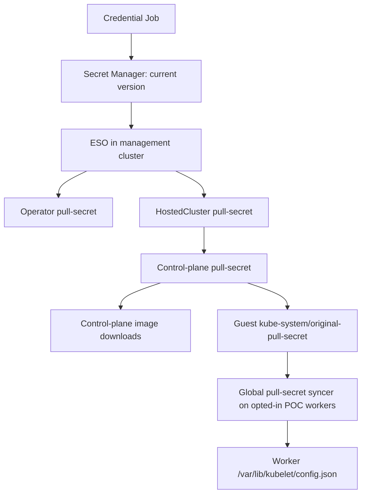

# GAR pull-secret lifecycle: how it would work

This is a proposed implementation, not behavior already deployed in the POC.
The new code would be a credential-management script and a verification script,
run in Kubernetes Jobs. ESO would distribute credentials; it would not create
service-account keys or decide when an old key can be removed.

## Processes and identities

| Process | Identity and access | Responsibility |
| --- | --- | --- |
| Initial Job and scheduled CronJob | Kubernetes service account linked through GKE Workload Identity to a separate Google account | Create/manage keys on the download account; manage versions and aliases on one Secret Manager secret; record rotation progress. |
| Download account | Existing `gar-pull-secret-poc@drejniak-hcp-dev.iam.gserviceaccount.com` for the POC | Read images through GAR. Its JSON key becomes the pull-secret login. |
| Existing ESO controller | Its existing Workload Identity, granted read access to the credential secret | Read the selected secret version and merge its GAR login into Kubernetes pull secrets. |
| Verification Job | Kubernetes access limited to the selected POC namespaces and test HostedCluster | Check final Secrets, worker files, and fresh downloads; report success for a specific key. |

The Job's identity and the download identity are separate. The Job obtains its
Google API credentials through GKE; its own credentials are not placed in the
pull secret. Deployment setup creates these identities and permissions before
starting the Job. Managing Secret Manager aliases additionally requires
`secretmanager.secrets.update` on that secret.

## 1. The Job creates the actual login

On first deployment the Job adopts an existing usable login or creates one.
For a new login, the script performs these operations:

1. Call Google's IAM `projects.serviceAccounts.keys.create` API for the download
   account, equivalent to the `gcloud iam service-accounts keys create` call in
   [the existing script](../scripts/setup.sh).
2. Keep the returned Google credentials JSON in a private temporary file. It
   contains `client_email`, `private_key_id`, and the private key.
3. Build this Docker configuration, preserving the complete JSON key as the
   password:

   ```json
   {
     "auths": {
       "us-central1-docker.pkg.dev": {
         "auth": "BASE64_OF__json_key:COMPLETE_JSON_KEY"
       }
     }
   }
   ```

4. Authenticate with the new key and request a required image manifest from the
   virtual GAR repository. Retry temporary propagation failures without
   creating another key.
5. Call Secret Manager's `addVersion` API with the Docker document as its
   payload. Record the returned version number and the key's `private_key_id`.
6. Select that version for delivery and remove temporary private files.

The private key is returned at creation; later key-list/get calls cannot recover
it. The script must publish it successfully or remove the unpublished key.
See [IAM key creation](https://docs.cloud.google.com/iam/docs/reference/rest/v1/projects.serviceAccounts.keys/create)
and [GAR JSON-key authentication](https://docs.cloud.google.com/artifact-registry/docs/docker/authentication#json-key).

## 2. A named version controls when consumers switch

Use the Secret Manager version alias `current`. This refines the original
`latest`-based proposal by separating uploading a candidate from activating it.

For example, version 7 contains key A. Uploading version 8 with key B leaves
`current` pointing at version 7 until the candidate passes its checks. Then the
Job changes `current` to version 8. Both keys remain enabled during delivery.

The equivalent activation command, using illustrative version numbers, is:

```bash
gcloud secrets update gar-pull-secret-poc \
  --project=drejniak-hcp-dev \
  --update-version-aliases=current=8
```

Rollback changes `current` back to 7 and re-enables key A if necessary. Secret
Manager supports [reading versions by alias](https://docs.cloud.google.com/secret-manager/docs/assign-alias-to-secret-version).
Validate alias reads with the installed ESO version before adopting this path.

The GAR reference in each existing ExternalSecret would become:

```yaml
# Excerpt from spec; preserve the existing base-secret inputs and merge template.
refreshPolicy: Periodic
refreshInterval: 1m
data:
  - secretKey: garPullSecret
    remoteRef:
      key: gar-pull-secret-poc
      version: current
    sourceRef:
      storeRef:
        kind: ClusterSecretStore
        name: gcp-gar-pull-secret-poc
```

When adopting the existing POC credential, assign `current` to its version
before changing ESO to request that alias. The one-minute refresh is a POC
setting, not the proposed production rotation interval.

## 3. Existing controllers carry the login to its consumers



ESO reads the selected version on its refresh interval and runs the existing
merge template. The current POC has an intermediate `gcp-gar-pull-secret` Secret,
which the final `pull-secret` ExternalSecret imports. Both stages must refresh.

HyperShift reads the final HostedCluster Secret and copies it into the
control-plane namespace. HCCO copies its contents into the guest cluster's
`kube-system/original-pull-secret` and maintains the combined control-plane
credentials. No new Secret name is needed for every rotation.

The existing [worker syncer](../../sync-global-pullsecret/sync-global-pullsecret.go)
checks its mounted Secret every 30 seconds. On a change it atomically updates
`/var/lib/kubelet/config.json` and restarts kubelet. This does not replace the VM,
but the kubelet restart must be included in POC validation. Enabling scheduling
on selected GCP Replace workers is still an experiment to validate.

New workers obtain their first credential from generated ignition data. This
path must also be updated correctly; a running worker syncer cannot repair a
worker that cannot bootstrap.

## 4. The verifier measures delivery instead of assuming it

The credential Job records the expected key ID and starts a verification Job
for the selected POC HostedCluster. The verifier would:

- Read the final operator Secret, HostedCluster Secret, control-plane copy, and
  guest copy. Decode only the GAR auth entry in memory and compare the embedded
  `private_key_id` with the expected key. Other registry entries can differ.
- Run a temporary checker Pod on each selected worker. Mount the node's
  credential file read-only and compare the GAR entry against the expected
  key. Return only the node name, key ID, timestamp, and success/failure.
- Check Node readiness and perform fresh registry authentication and image
  downloads. A healthy Pod, an existing cached image, or a Ready ExternalSecret
  alone does not prove that the new credential is in use. GKE's own image-pull
  permissions must not be mistaken for proof of pull-secret authentication.
- Test scale-out of an existing POC NodePool after a forced rotation, including
  after restarting ignition to remove reliance on a previously cached payload.

For the POC, the verifier can use the selected HostedCluster's kubeconfig from
its management namespace, kept only in the Job. Creating worker checker Pods
requires guest-cluster permissions and access to host files; keep that access
in the POC verifier rather than granting it to the Google key-management
identity. Record results for that rotation only, not a permanent "ready" flag.

Scale-out and ignition restart are test operations during POC validation, not
actions every scheduled production rotation should perform.

## 5. Job restarts resume recorded progress

Use a Kubernetes Lease shared by the initial Job and CronJob to prevent
overlapping invocations. `concurrencyPolicy: Forbid` on the CronJob alone does
not exclude separately created Jobs.

Store non-secret progress in a ConfigMap. For example:

```yaml
apiVersion: v1
kind: ConfigMap
metadata:
  name: gar-credential-rotation
  namespace: hypershift
data:
  phase: "Distributing"
  currentVersion: "8"
  currentKeyID: "key-b"
  previousVersion: "7"
  previousKeyID: "key-a"
```

The script advances through these steps across invocations:

```text
Create candidate -> Check GAR access -> Select current version
  -> Verify consumer updates -> Disable previous key
  -> Observe fresh downloads -> Delete previous key
```

If verification times out, keep the previous key enabled, record the missing
consumer, and retry verification on the next run. Do not mint another key.
If verification fails after disabling the previous key, re-enable it and
restore the previous alias. Only delete it after successful observation.

Reconcile Google key/version records with saved progress after a crash. In
particular, detect an unpublished key or a published version whose progress
record was not saved. Never infer that an unknown key is safe to delete simply
because its Job no longer exists.

The initial Job runs on deployment. A CronJob runs the same script daily to
check credential age or resume an unfinished replacement. A forced-rotation
test uses the same code path without waiting for the normal age threshold.

## 6. The bootstrap change must be explicit

Current [NodePool token code](../../hypershift-operator/controllers/nodepool/token.go)
records the pull-secret hash when creating token data. The
[ignition provider](../../ignition-server/controllers/local_ignitionprovider.go)
rejects generation if the current Secret does not match that recorded hash.
Existing cached payloads can also contain an earlier credential.

The candidate implementation needs to reconcile a changed credential hash for
active tokens and invalidate affected cached ignition payloads. It must also
ensure that a Secret update triggers this reconciliation. Keep the NodePool
rollout hash and token identity stable if possible; do not solve routine
rotation by replacing all workers. Review and test that behavior before
enabling automatic old-key removal. This is actual lifecycle work beyond
writing CronJob and ESO YAML.

## 7. Regional deployment uses the same operations

Supply the regional project, download account, secret, and GAR hostname as
configuration. Run one credential manager per region. Run verification close
to each management cluster and collect results for the expected key ID before
retiring a key shared across that region. An unreachable consumer blocks
retirement.

The manager must have a configured consumer list and permission to read each
management cluster's verification result. Discovery and regional result
collection are additional implementation work; ESO provides neither of them.
The POC starts with its operator and one HostedCluster.

This job manages the GAR download credential. The upstream Quay and Red Hat
passwords and the other entries in the base OpenShift pull secret retain their
separate owners and renewal processes.
